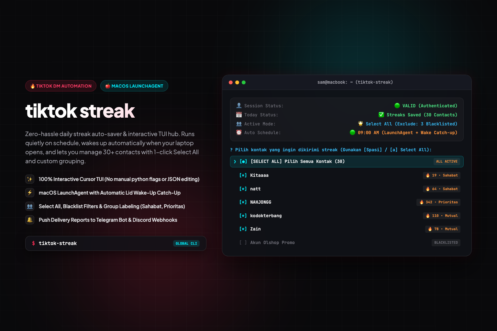

# ⚡ tiktok-streak — TikTok Streak Auto-Saver & Helper Hub

<p align="center">
  
</p>

[](https://www.python.org/)
[](LICENSE)
[](#)
[](#)

A zero-hassle, cross-platform **100% interactive cursor CLI hub** and daily streak assistant for **TikTok**.

Modeled around the same simple philosophy as **genshin-checkin / hoyolab**: **"Run and pick options easily."** No manual python execution commands, no JSON hacking, full arrow-key cursor navigation, multi-select checkboxes, in-app auto-updating, and automatic background streak sending with wake-up catch-up whenever you want it.

---

## 🌟 Fitur Utama

- **100% Interactive Cursor TUI**: Tampilan visual terminal modern dengan navigasi panah (`↑` / `↓`), pilihan checklist spasi (`Space`), tombol `a` untuk *Select All / Invert*, dan `Enter` untuk konfirmasi (tanpa perlu ketik-ketik angka manual). Cukup ketik `tiktok-streak` langsung di terminal!
- **Konfigurasi Pesan Dinamis & Anti-Bot**:
  - **Daftar Pesan Acak (Message Pool)**: Rotasi variasi pesan otomatis tiap hari agar tidak monoton dan tidak terdeteksi bot/spam oleh TikTok.
  - **Template Variabel Cerdas**: Mendukung `{name}` (nama kontak), `{first_name}` (nama depan), `{time_greeting}` (Pagi/Siang/Sore/Malam otomatis sesuai jam kirim), `{day}` (Senin/Selasa/...), dan `{date}` (tanggal hari ini).
  - **Pesan Khusus per Kontak (Contact Overrides)**: Personalisasi pesan spesial untuk kontak tertentu (misal: pacar / sahabat).
  - **Emoji Booster**: Opsi menambahkan variasi emoji api/energi acak (`🔥`, `⚡`, `✨`, `💪`, `🚀`).
  - **Pratinjau Pesan (Live Preview)**: Cek simulasi pesan yang akan diterima teman secara real-time sebelum dikirim.
- **Pengaturan Kecepatan (Pacing) & Anti-Ban**:
  - Pilihan ritme jeda: *Cepat (1-2s)*, *Normal / Natural (3-5s)*, atau *Santai (5-8s)* dengan natural jitter.
  - **Batas Jam Aman (Safe Hours)**: Mencegah pengiriman pada tengah malam (misal 07:00 - 23:00) jika laptop terbangun di waktu subuh.
- **Sistem Audit Logging (Retensi 3 Hari)**:
  - Menyimpan rekap lengkap seluruh pekerjaan yang dilakukan (pengiriman per kontak, status, pesan terkirim) serta riwayat perubahan konfigurasi.
  - Otomatis menghapus berkas catatan log yang lebih tua dari 3 hari (*auto-prune*), menjaga penyimpanan tetap hemat dan bersih.
  - Menu khusus *Log Viewer* interaktif dengan filter kategori (`JOB`, `CONFIG`, `SYSTEM`, `ERROR`).
- **In-App Auto-Updater**: Setiap kali aplikasi dibuka, sistem secara otomatis mengecek rilis pembaruan terbaru via endpoint `wsnsam.my.id` (dengan fallback GitHub). Dilengkapi visual progress bar, modal changelog pembaruan, dan 1-klik pasang update langsung di tempat tanpa perlu install ulang!
- **Multi-Select Contact Checklist**: Pilih kontak penerima dengan mudah dalam bentuk array interaktif atau gunakan mode 1-klik *Select All*.
- **Daftar Pengecualian (Blacklist / Exclude)**: Lewati akun resmi TikTok, akun olshop, atau orang tertentu secara otomatis di mode *Select All*.
- **Grouping & Labeling**: Kelompokkan kontak ke label (*Sahabat*, *Prioritas*, *Mutual*, dll.) dengan pesan kustom untuk masing-masing grup.
- **Auto-Scan DM Contacts**: Deteksi otomatis nama-nama kontak di DM TikTok Anda langsung dari menu terminal menggunakan browser session yang persisten.
- **Cross-Platform Daily Automation**:
  - **macOS**: Otomatis mendaftarkan **LaunchAgent** (`launchd`) jam 09:00 pagi dengan *wake-up internet readiness waiter* dan *hourly catch-up intervals* sepanjang hari.
  - **Windows**: Terintegrasi dengan **Windows Task Scheduler** (`schtasks`).
  - **Linux**: Terintegrasi dengan **Crontab**.
- **Notifikasi ke HP**: Kirim rekap hasil pengiriman streak ke **Telegram Bot** atau **Discord Webhook**, serta banner notifikasi native macOS.

---

## 🖥️ Terminal Dashboard

```text
==========================================================
⚡  TikTok Streak Auto-Saver & Helper Hub
==========================================================
👤 Akun Sesi:      🟢 VALID (Aktif)
📅 Status Hari Ini: ✅ Streak Sudah Terkirim (21 kontak)
👥 Mode Penerima:   👥 Groups / Labeling
💬 Konfigurasi:     🎲 Pool Acak | ⚡ Pace: Normal
⏰ Jadwal Auto:     🟢 Active (macOS LaunchAgent @ 09:00 with Wake-up Catch-up)
📁 Log History:     Tersimpan 3 hari terakhir (Auto-prune)
==========================================================
? Pilih Menu: (Gunakan tombol panah ↑/↓)
 ❯ 🚀 Kirim Streak Sekarang (Run Check-in)
   👥 Kelola Penerima & Grup (Select All / Checklist)
   💬 Konfigurasi Pesan & Template (Message Settings)
   ⚙️  Pengaturan Kecepatan & Sistem (Safety & Browser)
   📜 Riwayat Aktivitas & Log (Tersimpan 3 Hari)
   🔍 Pindai Kontak DM dari TikTok (Auto-detect)
   ⏰ Pasang / Atur Jadwal Harian (Catch-up saat laptop nyala)
   🔑 Login / Hubungkan Akun TikTok (Browser Window)
   🔔 Pengaturan Notifikasi (Telegram / Discord)
   🔄 Cek Pembaruan Aplikasi (Check for Updates)
   🚪 Keluar
```

---

## ⚡ Quick Start

### 🍎 macOS & 🐧 Linux

1. Masuk ke folder repository dan jalankan installer:
   ```bash
   chmod +x install.sh && ./install.sh
   ```
2. Setelah itu, buka terminal mana saja dan cukup ketik:
   ```bash
   tiktok-streak
   ```

### 🪟 Windows

1. Double-click file **`tiktok-streak.bat`** (atau jalankan `tiktok-streak.bat` di PowerShell / CMD).

---

## 🔄 Pembaruan Otomatis (In-App Auto-Updater)

Aplikasi memiliki sistem update bawaan yang terhubung ke endpoint `https://wsnsam.my.id/api/updates?app=tiktok-streak`:

1. **Auto Check saat Startup**: Tiap kali `tiktok-streak` dibuka, aplikasi akan menampilkan progress bar:
   ```text
   [*] Memeriksa pembaruan terbaru... [v1.2.0 - Versi terbaru!]
   ```
2. **Pemberitahuan Versi Baru**: Jika ada rilis baru, changelog lengkap akan ditampilkan dengan dialog interaktif:
   ```text
   🎉 Pembaruan Baru Tersedia! (v1.2.0 -> v1.3.0)
   📋 Apa yang baru:
      • Peningkatan kecepatan pengiriman streak
      • Fitur penjadwalan kustom fleksibel
   
   ? Apakah Anda ingin memasang pembaruan sekarang?
    ❯ 🚀 Pasang Pembaruan Sekarang (Auto-update in-app)
      ⏭️  Lewati (Skip untuk sekarang)
   ```
3. **In-Place Update**: Saat memilih pasang, skrip akan mengunduh versi terbaru dan memperbarui file secara otomatis, lalu merestart aplikasi tanpa perlu instalasi ulang manual.

---

## 🔑 Alur Pemakaian Pertama Kali

1. **Jalankan:** Ketik `tiktok-streak` di terminal.
2. **Login Akun:** Pilih menu `🔑 Login / Hubungkan Akun TikTok`. Jendela browser akan terbuka. Login ke akun TikTok Anda (bisa scan QR dari aplikasi TikTok di HP). Tekan ENTER di terminal jika sudah login.
3. **Pindai Kontak:** Pilih menu `🔍 Pindai Kontak DM dari TikTok` untuk mendeteksi daftar nama teman Anda.
4. **Atur Penerima:** Pilih menu `👥 Kelola Penerima & Grup` untuk menentukan apakah ingin pakai mode *Select All* atau *Grouping* dengan interactive checkbox list.
5. **Aktifkan Jadwal:** Pilih menu `⏰ Pasang / Atur Jadwal Harian` agar berjalan otomatis setiap hari di latar belakang.

---

## 🛠️ CLI Flags (Power Users / Unattended)

```bash
tiktok-streak --cron      # Mode background otomatis (dipakai LaunchAgent / Task Scheduler)
tiktok-streak --force     # Paksa kirim streak hari ini tanpa dialog
tiktok-streak --scan      # Jalankan pemindaian kontak DM langsung
tiktok-streak --login     # Buka jendela login browser langsung
tiktok-streak --help      # Tampilkan bantuan parameter CLI
```

---

## 📄 Lisensi

MIT License © 2026 [Sam](https://github.com/sammmms).
